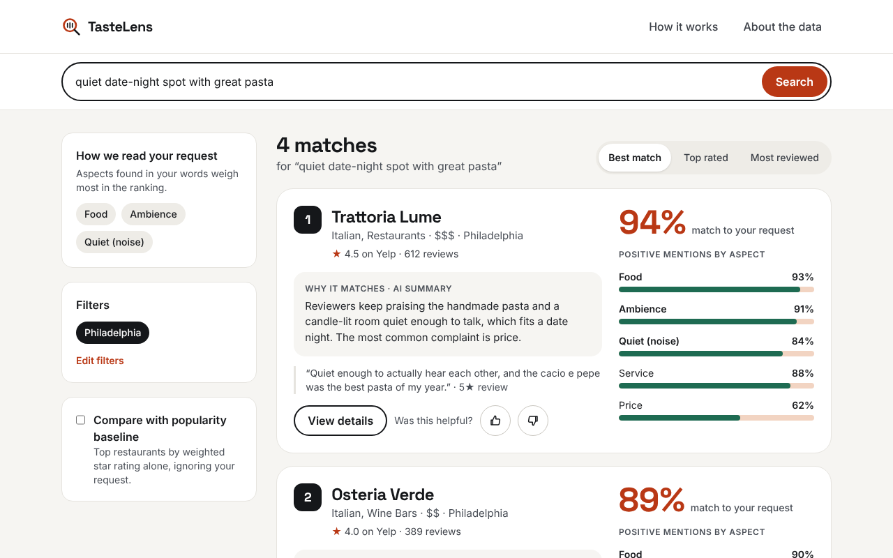

# TasteLens — Restaurant Recommender (NLP Text Analysis)

**Live app:** <LIVE_FRONTEND_URL> · **API docs:** <LIVE_API_URL>/docs

A restaurant recommender that reads what reviewers actually say. Star ratings hide nuance: a 4-star review can praise the food and complain about slow service. TasteLens scores each restaurant on food, service, ambience, price, noise and wait time from review text, then matches those scores to a plain-language request such as *"quiet date-night spot with great pasta"*.

**Course:** NLP / Generative AI · **Type:** group project



<sub>Screenshots use the sample data in `frontend/mocks/`. Replace them with screenshots of the live app before the final presentation.</sub>

## How it works

1. **Review ingestion**: Yelp Open Dataset restaurants and reviews → parquet.
2. **Preprocessing**: cleaning (duplicates, reviews under 20 characters, reviews before 2015, restaurants with fewer than 15 reviews), sentence splitting.
3. **Aspect extraction + sentiment**: each sentence is tagged with aspects (keyword lexicon) and scored by an aspect-based sentiment model.
4. **Semantic search**: `all-MiniLM-L6-v2` fine-tuned on (review, restaurant categories) pairs; one vector per restaurant in a FAISS index.
5. **Recommendation**: `hybrid = 0.5 × semantic match + 0.3 × aspect fit + 0.2 × weighted rating`.
6. **Generative summary**: an LLM explains each pick in two sentences, with a template fallback.

```text
Browser ──► Next.js frontend (Vercel) ──REST/JSON──► FastAPI (Render)
                                                       ├─ ONNX query encoder
                                                       ├─ FAISS index + aspect profiles
                                                       ├─ LLM summary (Anthropic / OpenAI)
                                                       └─ feedback → Postgres (Neon)
Yelp JSON ──► scripts/01…06 (offline) ──► artifacts ──► private Hugging Face Hub repo
```

## Project layout

```text
recommender/   NLP package: pipeline, preprocessing, sentiment, embeddings, ranking, summary
scripts/       offline jobs that build the artifacts, run in order 01 → 06
api/           FastAPI backend (+ Dockerfile)
frontend/      Next.js website (+ Dockerfile for docker-compose)
notebooks/     experiments: EDA, baseline, sentiment, fine-tuning
artifacts/     git-ignored build outputs (parquet, profiles, index, model)
data/          raw Yelp JSON goes here (git-ignored, see data/README.md)
tests/         pytest suite
docs/          proposal, evaluation, hosting decision, screenshots
```

## Setup

Requires Python 3.11 and Node 22.

```bash
git clone https://github.com/<your-org-or-username>/restaurant-recommender-nlp.git
cd restaurant-recommender-nlp
python3.11 -m venv .venv
source .venv/bin/activate          # Windows: .venv\Scripts\activate
pip install -r requirements.txt -r requirements-dev.txt
cp .env.example .env               # then fill in the values you need
```

Three requirement files:

| File | For | Contains |
| --- | --- | --- |
| `requirements.txt` | the API (and its Docker image) | FastAPI, onnxruntime, FAISS, pandas, LLM clients |
| `requirements-ml.txt` | the offline pipeline (`scripts/`, notebooks) | everything above + PyTorch, transformers, sentence-transformers, optimum, spaCy |
| `requirements-dev.txt` | tests and linting | pytest, ruff, jupyter, onnx, spaCy |

## Build the artifacts (offline pipeline)

Download the Yelp Open Dataset into `data/` first (see [data/README.md](data/README.md)), then `pip install -r requirements-ml.txt`.

| Step | Command | Output in `artifacts/` |
| --- | --- | --- |
| 1 | `python scripts/01_build_dataset.py` (add `--city Philadelphia` for a quick run) | `restaurants.parquet`, `reviews.parquet` |
| 2 | Run `notebooks/finetune.ipynb` | `restaurant-model/` |
| 3 | `python scripts/02_build_profiles.py` (`--device 0` on a GPU) | `aspect_profiles.parquet`, `aspect_snippets.parquet` |
| 4 | `python scripts/03_build_index.py` | `restaurants.faiss`, review snippet store |
| 5 | `python scripts/04_evaluate.py --city Philadelphia` | `docs/evaluation.md` |
| 6 | `python scripts/06_export_onnx.py` | `onnx/` |
| 7 | `python scripts/05_upload_artifacts.py` | private Hub repo `HF_REPO_ID` |

## Run locally

```bash
# terminal 1: API on http://localhost:8000 (docs at /docs)
uvicorn api.main:app --reload

# terminal 2: website on http://localhost:3000
cd frontend && cp .env.example .env.local && npm install && npm run dev
```

Or both at once with Docker: `docker compose up --build`.

## Tests and checks

```bash
ruff check . && ruff format --check . && pytest
cd frontend && npm run lint && npm run build
```

CI runs the same checks on every pull request (`.github/workflows/ci.yml`).

## Deployment

Frontend on Vercel, API on Render, feedback in Neon Postgres, artifacts in a private Hugging Face Hub repo. Details, limits and fallbacks: [docs/hosting.md](docs/hosting.md).

## Evaluation

Retrieval recall and a 20-query comparison against the popularity baseline: [docs/evaluation.md](docs/evaluation.md).

## Data and licence

The Yelp licence forbids redistributing the dataset: no data is committed, and the Hub repo holding derived files stays private. The app shows short review snippets for educational use.

## Team

- Yannick Kuete
- Luc Dinh
- Tej Kandimalla

## License

MIT — see `LICENSE`.
